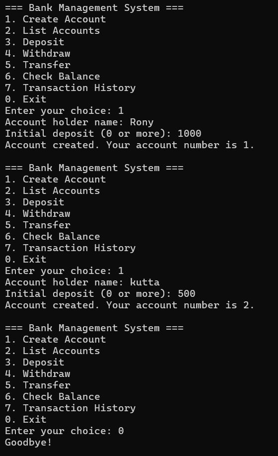

# Bank Management System

A console-based Bank Management System written in Python with an SQLite database. It supports accounts, deposits, withdrawals, transfers and a full transaction history.

## Features

- Create accounts with an optional initial deposit
- Deposit and withdraw money with balance checks
- Transfer between accounts as a single atomic transaction (both updates succeed or neither does)
- Transaction history for every account
- Database constraints prevent negative balances
- Input validation and parameterized SQL queries

## Technologies Used

- Python 3
- SQLite (built-in sqlite3 module)

## Database Design

- accounts (id, name, balance)
- transactions (id, account_id, type, amount, note, created_at)

## How to Run

1. Clone the repository
2. Make sure Python 3 is installed
3. Run: python main.py

The database file bank.db is created automatically on first run.

## Author

Rony - https://github.com/Rony60031
